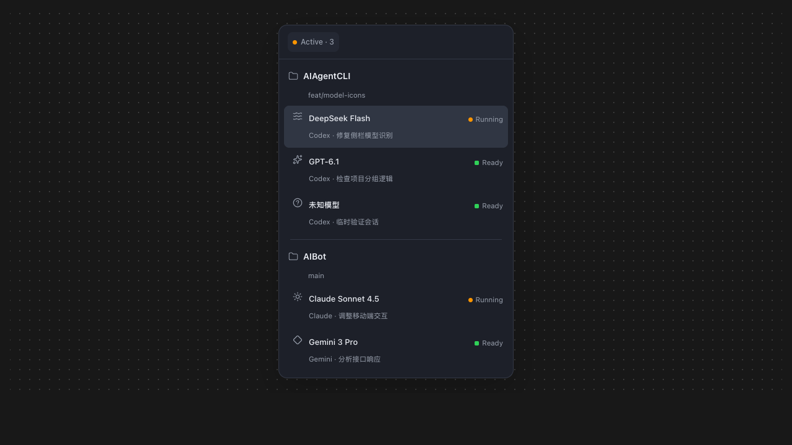

<!--
状态: active
创建: 2026-10-01
最后更新: 2026-11-13
关联: src/aia-projects.js; docs/upstream.md
-->

# AIAgentCLI

一个面向 cmux 的项目式侧栏：按本机目录整理项目，并把每个 Agent 会话使用的实际模型直接显示在侧栏中。



## 主要效果

- **按目录归组**：同一目录下的工作区自动放入同一个项目。
- **显示实际模型**：同一工作区里的 DeepSeek、GPT、Claude、Gemini 等会话分别显示。
- **统一图标风格**：使用简洁的灰色线性图标，不采用品牌彩色 Logo。
- **未知模型兜底**：无法识别时统一显示“未知模型”和问号图标。
- **任务状态清晰**：橙点表示 `Running`，绿色方块表示 `Ready`。
- **保留完整会话**：`Active` 只展开或折叠项目，不会隐藏终端和闲置对话。
- **完整项目操作**：支持嵌套分组、拖拽排序、标题颜色和批量关闭。

## 安装

要求：

- macOS
- cmux 0.64.25 或更高版本
- 已启用 cmux 自定义侧栏

在 cmux 终端中执行：

```sh
git clone https://github.com/djejjd/AIAgentCLI.git
cd AIAgentCLI
./install.sh --dev
```

安装完成后，在 cmux 左下角选择 `aia-projects`。

### 更新

```sh
git pull
./install.sh --dev
```

### 可选：扩大侧边栏最小宽度

```sh
defaults write com.cmuxterm.app sidebarMinimumWidth -float 260
cmux reload-config
```

## 模型图标

| 模型 | 图标风格 |
|---|---|
| DeepSeek | 水波纹 |
| OpenAI / GPT | 星芒 |
| Anthropic / Claude | 太阳 |
| Google / Gemini | 菱形 |
| 其他或未知 | 问号 |

## 来源

本项目基于 [s4ff0x/cmux-sidebar](https://github.com/s4ff0x/cmux-sidebar) 衍生，上游基础来自 cmux 官方示例。

许可证：GPL-3.0-or-later。
