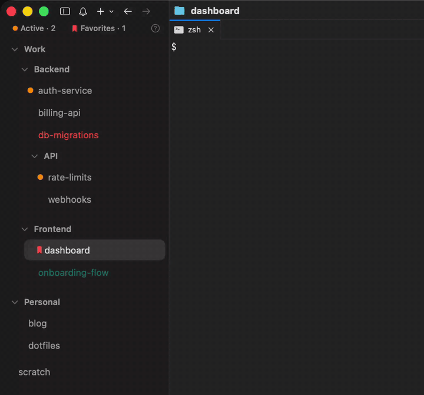

<!--
状态: active
创建: 2026-10-01
最后更新: 2026-11-12
关联: src/aia-projects.js; https://github.com/s4ff0x/cmux-sidebar
-->

# cmux-aia-projects

基于 [s4ff0x/cmux-sidebar](https://github.com/s4ff0x/cmux-sidebar) 的 cmux 项目式侧栏。它按本机工作目录自动建立项目分组，同时保留工作区、终端和 Agent 会话的完整列表。

这是从上游 fork 出来的独立仓库，但仍属于相同 GPL 代码谱系。上游基础来自 cmux 官方
[`Examples/CustomSidebars/workspaces.js`](https://github.com/manaflow-ai/cmux/blob/main/Examples/CustomSidebars/workspaces.js)。



- **按目录自动归组。** 同一路径下的工作区归入一个项目，使用宿主持久化分组。
- **保留完整会话。** Active 只控制项目展开和收起，不隐藏终端、闲置对话或已结束会话。
- **Agent 状态。** 橙色表示正在运行；绿色表示你离开后完成了回合，打开后被清除。
- **原生分组和拖拽。** 保留上游的嵌套分组、拖拽排序、批量关闭和标题颜色能力。

当前开发版从 clone 安装：

```sh
git clone https://github.com/djejjd/cmux-sidebar.git
cd cmux-sidebar
./install.sh --dev
```

需要 cmux 0.64.25 或更高版本。开发和问题反馈请使用
[djejjd/cmux-sidebar](https://github.com/djejjd/cmux-sidebar/issues)。

本项目运行在 cmux 的自定义侧栏运行时中，入口是 `src/aia-projects.js`。上游性能和实现背景见
[mendelson.dev/work/cmux-sidebar](https://mendelson.dev/work/cmux-sidebar/)。

## Features

- **Nested groups.** Workspace groups nest by name (see below), each level indented and
  independently collapsible.
- **Activity dots.** Orange marks a workspace whose coding agent is really working, mid-turn or
  with a running subagent. Waiting for input, idle, and ended are not working. Green marks a
  workspace whose turn **finished while you were elsewhere**; it stays green until you open that
  workspace. A group header shows its own anchor workspace's dot; headers show no counts. cmux
  can keep a session at "working" after it went quiet (an interrupted Claude Code turn, an omp
  turn with a background job pending, a session restarted in the same terminal); the sidebar
  works around that, see [Supported agents](#supported-agents).
- **Row titles follow the agent's pane.** cmux names a workspace after its focused pane, so a
  split with a shell, a dev server or a file viewer in front hides the title the agent
  generates. The row shows the agent pane's title instead while the focused pane hosts no agent.
  A workspace you renamed keeps its name. In the rename editor, Return on the unchanged name
  changes nothing (a rename would pin the generated title as a custom one).
- **Recently finished clock (optional, off by default).** Turn it on in **Settings** (below).
  A green clock icon before the title marks a workspace whose agent finished a turn less than an
  hour ago, whether you were there or elsewhere. It hides an hour after the latest finish, and
  opening the workspace (in the sidebar or anywhere in cmux) restarts that hour. Marking it
  important or a new turn never clear it. During a new turn the clock stays beside the orange
  dot, and that turn's finish starts a new hour. A group header shows its anchor workspace's
  clock. It survives a sidebar mount in most cases (see the limits below). The sidebar tracks
  finishes while the clock is off, so turning it on shows the clocks of the last hour at once.
- **Settings.** Set them in the `SETTINGS` block at the top of
  `~/.config/cmux/sidebars/aia-projects.js`: `recentClock: true` turns on the recently finished
  clock. An update replaces that file, so set them again after updating. The Settings page is
  hidden for now: `settingsPage: true` shows a gear at the right of the top bar that opens it in
  place of the list, with the recently finished clock toggle. The cmux sidebar runtime has no
  storage, so a change made on that page lasts until the sidebar mounts again (cmux launch, a
  source edit, a sidebar switch).
- **Sidebar Guide.** The `?` at the right of the top bar, or **Sidebar Guide** at the end of any
  right-click menu, shows a short guide to every icon, the top bar and the mouse, in place of the
  list. Click the guide (or the `?`) to close it.
- **Active folding.** **Active · N** expands every project containing an active workspace.
  Turning Active off folds those same projects again. It never filters individual workspace
  rows, so terminals and idle conversations remain in the group.
- **New workspaces open at once.** A group's `+` (or **New Workspace in Group**) and a
  double-click on the empty area open the new workspace as soon as cmux creates it.
- **Favorites.** The upstream Favorite / Favorites controls are retained in code but hidden by
  default in this fork. Set `showFavoritesFilter` or `showFavoriteAction` to `true` in
  `SETTINGS` to restore them.
- **Title color.** Right-click a workspace → **Title Color** draws its title in Red, Orange,
  Yellow, Green, Teal, Blue, Purple, or Pink; **None** clears it. With a multi-selection, every
  selected row takes the color. The title color is the native cmux workspace color, so it
  persists, and the built-in sidebar shows it as the workspace's border. A color set outside this
  sidebar (the built-in sidebar, `cmux workspace-action set-color`) colors the title too.
- **Important.** Right-click a workspace → **Mark as Important** / **Unmark Important**: a
  shortcut for **Title Color → Red** / **None**. An important workspace keeps its place (it is a
  color, not a pin). cmux's own named Red (`#C0392B`) counts as important too and is drawn in the
  same red.
- **Collapse keeps active work visible.** A collapsed group hides everything except working and
  finished-unopened workspaces, listed under its header with a dim breadcrumb (`Backend › API ›`)
  when they come from a subgroup.
- **Create inside a group.** Use the hover `+` on a group header, or right-click →
  **New Workspace in Group**. Right-click a workspace → **Move to Group** lists the full tree.
- **Create at the top level.** Double-click the empty space under the list, as in the built-in
  sidebar: a new workspace opens at the end of the list, outside every group. cmux puts a custom
  sidebar inside a scroll view, so no view can reach down to the bottom edge; the empty area is a
  160 pt band under the last row instead.
- **Multi-select.** ⇧-click selects a range of rows: from the open workspace, or from your last
  click while a selection is already open. ⌘-click adds or removes one row. While 2 or more rows
  are selected, a **✕ Close N** chip shows at the right of the top bar and closes them all in one
  click; right-click a selected row → **Close N Workspaces** does the same. ⌘W cannot: cmux sends
  custom sidebars no key events, and ⌘W is cmux's own **Close Tab**, which closes the focused
  terminal tab.
- **Drag and drop.** Drag a row to reorder it, or into or out of a group. While you drag, the
  group the row will land in lights up blue: its header strongly, its rows lightly; nothing lights
  up for the top level. Below each open group's last row sits a thin gap: drop the row past it to
  leave the group. Where several groups end together, each gap below steps out one more level.
  At a group's last row the pointer's X position still works too: drag left to land one level out.
- **Bulk close is one step.** Closing several workspaces hides them all at once. Until cmux has
  closed every one, a spinner shows in the top bar and the list stays still and dimmed, ignoring
  clicks and drags, so rows never vanish one by one or jump. If the open workspace is among
  them, the nearest remaining row opens first. A workspace cmux still lists after 30 seconds
  shows again.
- **Closing never asks.** cmux refuses a plain close for a favorite (pinned) workspace or one
  with a running process, so a close from this sidebar (✕, menu, or chip) unpins the favorite
  and forces the close. That ends whatever runs in the workspace, an agent included, without a
  prompt. If cmux still lists the workspace 5 seconds later, its row shows again, so a close that
  failed never looks like one that worked.

## Install

从当前开发分支安装：

```sh
git clone https://github.com/djejjd/cmux-sidebar.git
cd cmux-sidebar
./install.sh --dev
```

`--dev` 会把 `src/aia-projects.js` 链接到
`~/.config/cmux/sidebars/aia-projects.js`，源代码保存后会热重载。它不会覆盖已有的
`cmux-sidebar.js`。

Requirements: cmux 0.64.25 or newer (tested on 0.64.25, 0.65.1 and 0.65.2), with Custom Sidebars enabled
(the default; **Settings → Custom Sidebars**).

- **Update:** pull the branch and rerun `./install.sh --dev`.
- **Uninstall:** run `./install.sh --uninstall`, then pick another sidebar from cmux.
- **Without the script:** copy `src/aia-projects.js` to
  `~/.config/cmux/sidebars/aia-projects.js`, then pick `aia-projects` from the sidebar menu.

If a file named `aia-projects.js` that this installer did not write is already there, it is
moved to a timestamped `.bak` first. If the new file fails `cmux sidebar validate`, the previous
one is put back.

## Supported agents

The activity dots read the coding-agent sessions that cmux tracks through its agent hooks. cmux
exposes no process information to sidebars, so an agent without hooks never shows as working.

**Tested:**

- **Claude Code:** works out of the box; the cmux Claude wrapper injects its hooks. Claude Code
  sends no Stop hook when you interrupt a turn (Escape), so cmux keeps the session at "working"
  until the next prompt. The sidebar treats a Claude record with no hook activity for 10 minutes
  as stale: no dot. A working Claude session reports every tool call, so a real turn rarely goes
  quiet that long; one that does loses its dot until its next tool call, and its finish still
  turns green.
- **omp:** install the hooks once with `cmux hooks omp install`, then restart running omp
  sessions (omp loads the hook extension when a session starts). omp sends no Stop hook while a
  turn "will continue" (a background job or subagent still pending), so cmux can keep the
  session at "working" for hours. omp's own terminal title says whose turn it is
  (`tui.titleState`, on by default): `π > topic: title` is your turn, `π ! …` is waiting on
  you. The sidebar reads that title and shows no orange dot for either; a turn that ends this
  way still turns green. With the setting off, the dot follows cmux's record.

For every agent, a terminal tab keeps the records of every session it ever hosted, and a
superseded one (omp `/new`, an agent restarted in the same terminal) can sit at "working" for
good. Only the newest record per terminal tab counts. The stale check runs once a minute, so a
Claude record goes stale between 10 and 11 minutes after its last hook activity.

**Untested, expected to work:** the sidebar reads cmux's generic session status (working, needs
input, idle, ended); only the two workarounds above look at the agent kind. So any agent that
cmux hooks into should show the same dots once its hooks are installed with `cmux hooks setup` (or
`cmux hooks setup <agent>`). As of cmux 0.64.25 that list is Codex, OpenCode, Pi, Gemini, Cursor
CLI, Copilot, Amp, Grok, Kimi Code, Kiro CLI, Rovo Dev, CodeBuddy, Factory, Qoder, Campfire,
and Antigravity; see cmux's
[agent hook docs](https://github.com/manaflow-ai/cmux/blob/main/docs/agent-hooks.md). Reports
for other agents are welcome.

### Limits of the green dot and clock

cmux records no "last opened" or "turn finished" time, so the sidebar watches each workspace go
from working to finished itself and keeps that in memory. That memory starts empty whenever the
sidebar mounts: on cmux launch, when the source file changes, or when you switch to another
sidebar and back (`cmux sidebar reload` with an unchanged file does not remount).

- **Green dots** start empty then: a turn that finished before the mount shows no dot.
- **Clocks** are read back from cmux data then: a workspace gets its clock if its last prompt
  was less than an hour ago and an agent that is now idle or waiting for input was active after
  that prompt (so the prompt got its answer). The hour then runs from that answer, through any
  later turns. The data can't tell in three cases, so they show no clock after a mount: the
  prompt was more than an hour ago (a long turn, or turns that ran on without a new prompt), an
  agent is mid-turn at the mount, or the agent was quit since. A restart from opening the
  workspace lives in memory too, so after a mount the hour runs from the answer again.

Toggling a filter chip remounts rows but not the sidebar, so both survive it. The hour is
measured on the wall clock and checked once a minute, so a clock icon can stay up to a minute past
its hour.

## Nesting convention

cmux groups are flat, so this sidebar encodes the hierarchy in the group **name**, using `/` as
the separator:

| Group name         | Shown as                 |
| ------------------ | ------------------------ |
| `Work`             | `Work`                   |
| `Work/Backend`     | `Backend` under `Work`   |
| `Work/Backend/API` | `API` under `Backend`    |

- Only the leaf segment is shown. Siblings are ordered by tab position.
- If a parent path has no real group (for example `Work/Backend` exists but `Work` does not),
  the sidebar shows a *virtual* header for it. A virtual header's collapse state is local and
  resets when the sidebar reloads.
- Group header menu items:
  - **New Subgroup** creates `<path>/New Group` and opens it for rename.
  - **Rename Group** edits the leaf, and descendants follow. Typing `a/b` nests further.
  - **Move Group Into ›** and **Move to Top Level** move a group together with its subtree.
  - **Ungroup** and **Delete Group** dissolve the group the cmux way: member workspaces are
    kept. Its direct subgroups move up one level.
- Drag a header to move a group with its whole subtree. Drop it right under another group's
  header (or among its rows) to nest it there; past the gaps under a group's last row it moves
  out one level per gap. Dropping at the top level un-nests it.
- Tradeoff: the built-in cmux sidebar shows the full names (`Work/Backend`).

## Development

```sh
git clone https://github.com/djejjd/cmux-sidebar.git
cd cmux-sidebar
./install.sh --dev   # symlinks src/aia-projects.js into cmux, so saves hot-reload
npm test            # node:test suite, run against cmux's real SidebarRuntime.js
npm run check       # syntax check
cmux sidebar validate aia-projects
```

The tests load the runtime from the installed app
(`/Applications/cmux.app/.../SidebarRuntime.js`). Override the path with
`CMUX_SIDEBAR_RUNTIME=/path/to/SidebarRuntime.js`.

### Releasing

1. On a Mac with cmux installed, run `npm test` on the commit you want to release (CI cannot:
   the tests need the app's runtime).
2. Tag it and push the tag: `git tag v0.2.0 && git push origin v0.2.0`.
3. Publish `aia-projects.js` and `install.sh` as release assets. This fork has not created its
   first release yet, so use `./install.sh --dev` during development.

### Performance

The cmux runtime re-sends a reactive prop whenever anything it read notifies, and every data
key arrives as a freshly parsed object about once a second. To keep ticks cheap, the sidebar
reads data only through change-only memos (`memo`, `memoJSON`) and gives each workspace its own
signal, so a tick costs ops only for what actually changed. `test/perf.test.js` holds this
budget on a 60-workspace, 3-level fixture: an identical tick sends 0 scene ops (it used to send
about 1144), a clock tick sends 0 while a clock icon is shown, and one agent starting work touches
only its own row and the `Active` count.

Scrolling has a different cost. The host renders the list in a non-lazy SwiftUI `ScrollView`,
and every scroll frame re-processes each rendered scene node (every node carries its own hover
tracking), so scroll cost grows with nodes per row, not with data. Rows therefore mount only what
they show: the activity dot, recently finished clock, favorite bookmark, breadcrumb, and unread
badge mount on demand (a row without a dot keeps the slot as padding; a header's dot and clock
mount the same way), and the dot is one circle. A plain row is 7 nodes
(it was 13), a header 7 (was 9), with the same pixels. On a 102-workspace sidebar this cut the
cmux main thread from about 85% to about 52% busy while scrolling, and SwiftUI's render share
from about 55% to about 29%. The same `test/perf.test.js` holds the per-row node budget.

## License

GPL-3.0-or-later, see [LICENSE](LICENSE). This sidebar is derived from cmux's
`Examples/CustomSidebars/workspaces.js` (Copyright Manaflow, Inc., GPL-3.0-or-later).
